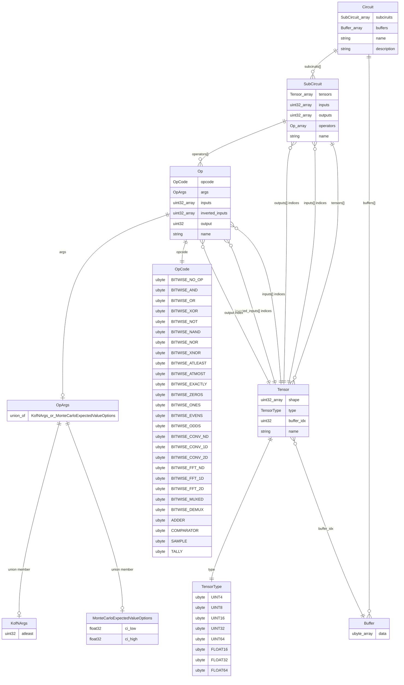

# pcfb
a library for representing probabilistic circuits as tensors. single source of truth for the probabilistic circuit flatbuffer PCFB schema

## Schema Layout

## Build
```shell
mkdir build && cd build
cmake -DPCFB_BUILD_TESTS=ON .. && cmake --build . && ctest
```

```
flatbuffers:
  is:
    - a memory efficient SerDe Library
    - https://github.com/google/flatbuffers
  language_framework: C/C++, CMake
  license: Apache v2.0
  provides:
    - [C++_API_PUBLIC] SerDe API in the `::flatbuffers` namespace
```

```
pcfb:
  is:
    - a SerDe library for representing probabilistic circuits as tensors
    - the single source of truth for the probabilistic circuit flatbuffer PCFB schema
  language_framework: C/C++
  license: MIT
  provides:
    - [FILE] probabilistic circuit flatbuffer PCFB schema, defined in `pcfb_v1.fbs`, for the PCFB-file format (`.pcfb`).
    - [FILE] an autogenerated flatbuffer C/C++ header file `pcfb_generated.h`, which has helper I/O ops that use the `::flatbuffers` API
    - [C++_API_PUBLIC] a small, high-level, functional C/C++ API/interface in the namespace `::pcfb`, including:
      - a thin wrapper over the classes in `pcfb_generated.h`, providing an intermediate representaion called `::pcfb:ir`
      - a namespace called `::pcfb::io`, for end-to-end SerDe ops on `::pcfb:ir` <-> PCFB (`.pcfb`) files
  implements:
    - internal functions to perform SerDe ops on `::pcfb:ir` <-> PCFB (`.pcfb`) files, implementing the methods defined in C/C++ API/interface in `::pcfb`.
  uses: flatbuffers
  inputs: [`.pcfb` files, `::pcfb:ir`]
  outputs: [`.pcfb` files, `::pcfb:ir`]
```

