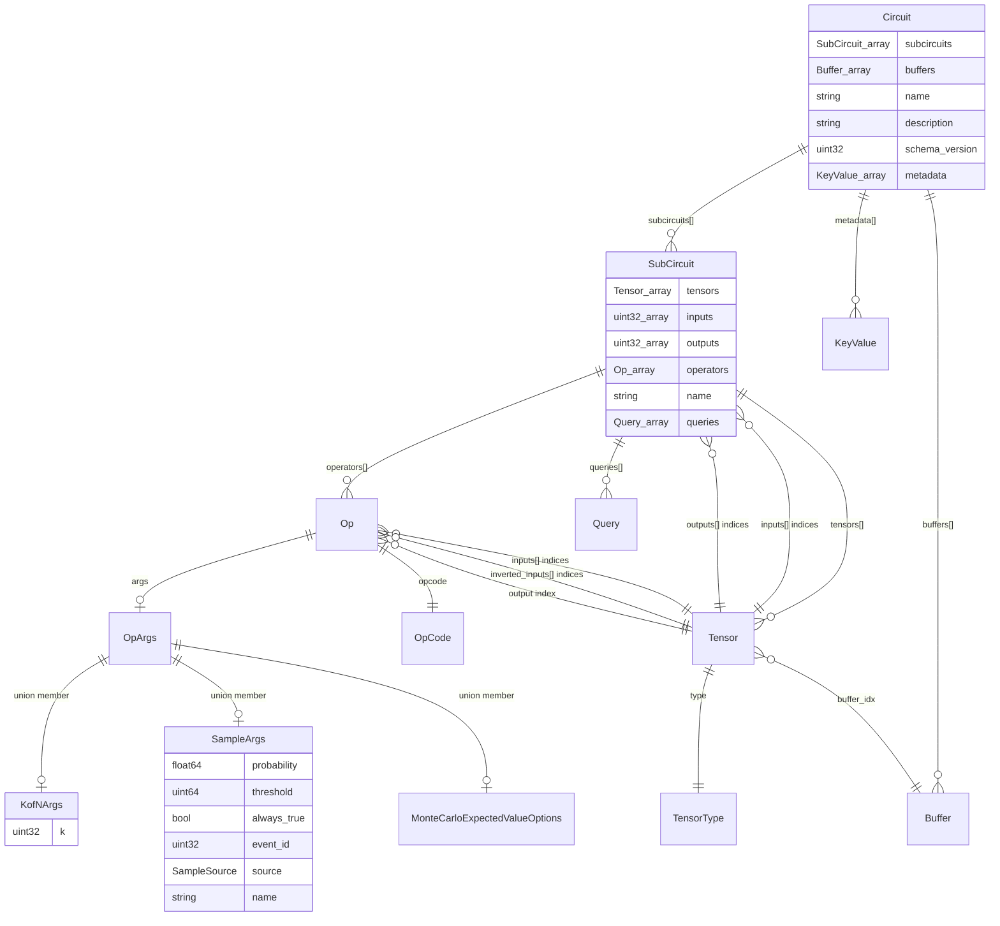

# pcfb

> **Status:** partial — verified 2026-11-18 (`flatc --conform` v1 → v1.1 with flatc 25.2.10).
> **Fate:** stays — the portable `.pcfb` artifact format (MIT).
> **What works today:** FlatBuffers schema v1 and a header-only mmap reader; v1.1 spec merged (docs/SPEC-v1.1.md); builder/validator in progress (pcfb#4).

a library for representing probabilistic circuits as tensors. single source of truth for the probabilistic circuit flatbuffer PCFB schema

## Build
```shell
mkdir build && cd build
cmake -S . -B build -DCMAKE_BUILD_TYPE=Release
cmake --build build
ctest --test-dir build --output-on-failure
# aliases: -DBUILD_TESTING=OFF, -DBUILD_TESTS=OFF, -DPCFB_BUILD_TESTS=OFF
```

Headers are generated at build time with `flatc` from FlatBuffers v25.2.10 (FetchContent). The canonical schema is `schema/pcfb.fbs` (v1.1); v1 is frozen at `schema/history/pcfb_v1.fbs` and checked with `flatc --conform`.

## Builder / reader example

```cpp
#include "pcfb.h"

#include <array>
#include <cstdint>
#include <iostream>

int main() {
    pcfb::builder b;
    auto a = b.add_sample(0.5, "A", /*event_id=*/0);
    auto c = b.add_sample(0.25, "B", 1);
    const std::array<std::uint32_t, 2> ins{*a, *c};
    auto z = b.add_op(pcfb::OpCode::BITWISE_AND, ins);
    b.add_query(*z, pcfb::QueryKind::PROBABILITY, "top");
    auto bytes = b.finish(); // required metadata + schema_version 0x00010001

    auto circuit = pcfb::io::from_bytes(*bytes);
    for (const auto &d : pcfb::validate(*circuit)) {
        std::cerr << d.location << ": " << d.message << "\n";
    }
    std::cout << "pcfb " << pcfb::version() << " subcircuits="
              << circuit->subcircuits()->size() << "\n";
}
```

`add_sample` also accepts an explicit `(threshold, always_true, name, event_id, source)` overload. Thresholds are `min(floor(p·2^64), 2^64−1)` (see `pcfb::probability_to_threshold`).

## Schema Layout


```
flatbuffers:
  is:
    - a memory efficient SerDe Library
    - https://github.com/google/flatbuffers
  language_framework: C/C++, CMake
  license: Apache v2.0
  provides:
    - [C++_API_PUBLIC] SerDe API in the `::flatbuffers` namespace
```

```
pcfb:
  is:
    - a SerDe library for representing probabilistic circuits as tensors
    - the single source of truth for the probabilistic circuit flatbuffer PCFB schema
  language_framework: C/C++
  license: MIT
  provides:
    - [FILE] canonical PCFB v1.1 schema `schema/pcfb.fbs` (identifier `PCF1`)
    - [FILE] autogenerated `pcfb_generated.h` (build-time `flatc`, FlatBuffers v25.2.10)
    - [C++_API_PUBLIC] `::pcfb` — `io::{read,from_bytes,write,to_bytes}`, `builder`, `validate`, `ir::Circuit`
  uses: flatbuffers
  inputs: [`.pcfb` files, `::pcfb::ir`]
  outputs: [`.pcfb` files, `::pcfb::ir`]
```

